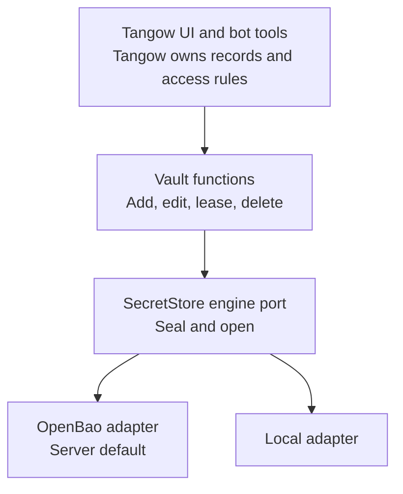

# Tangow vault architecture

This decision supersedes the November 18 vault architecture draft.

## Decision

The UI and bot tools use Tangow's existing vault functions. A single provider-neutral
`SecretStore` port determines how values are sealed and opened. The Tangow server
stack ships headless OpenBao as the default vault engine, with no user installation
step. OpenBao supplies the vault cryptography without new cryptographic code or
composition in Tangow.

## Three layers

1. **Tangow owns the records and access rules.** It keeps each entry's name, kind,
   site, owner, and shares, and decides who can use it, through which bot, and at
   which site. Today `main` scopes keys to a user, space, and bot. T3a brings over
   the per-person records and sharing rules from the earlier vault branch.
2. **The existing vault functions are the contract.** In
   [`bot-secrets.ts`](../../packages/adapters/src/bot-secrets.ts), add and edit use
   `storeBotSecret`. Lease uses `requestWithBotSecret`, which checks access and the
   saved origin, opens the value for one HTTP request, and keeps no cached
   credential. Delete uses `removeBotSecret` on the earlier vault branch and
   `forgetBotSecret` on `main` today.
3. **The engine port seals and opens values.** The existing
   [`SecretStore`](../../packages/adapter-kit/src/interfaces.ts) is bypassed by
   callers typed against `EncryptedSecretStore`, whose synchronous `load` sits
   outside the port. The port will expose seal and asynchronous open, with
   distinct failures for a value that cannot be found and an unavailable engine.
   OpenBao is the server-stack default. The current local adapter serves tests,
   development without Docker, desktop, and Tangow's other secrets.

Swapping engines later requires one new adapter that passes the same shared
offline conformance test. The rest of Tangow uses the same contract, as it does
with bot computer providers.

## Storage

OpenBao Transit holds the encryption key and performs encryption and decryption.
The sealed value stays in the same Postgres row as the vault record. The record
and its value update atomically, and cascade deletes leave no orphaned value.
A backup consists of one database dump plus OpenBao's own data. Each sealed
value is bound to its record ID. Opening it under a different ID must fail.

## Delivery slices

| Slice | Target | Scope |
| --- | --- | --- |
| T0 | No PR | Run a disposable OpenBao trial. |
| T1 | `feature/vault-openbao` | Put the three vault call sites behind the port: one seal and two opens, the second being the shared-skill check that opens every key of a space. Add shared offline conformance tests. |
| T2a | `feature/vault-openbao` | Add the OpenBao adapter, setting, Compose service, and install and restore docs. Keep existing engine selection. |
| T2b | `feature/vault-openbao` | Switch the server-stack vault to OpenBao and keep the local store for other secrets. If startup resealing is present when this lands, exclude OpenBao rows from it. |
| T3a | `feature/vault-openbao` | Re-propose the earlier per-person API keys, sharing, and web and mobile screens as one reviewable unit. |
| T3b | `feature/vault-openbao` | Finish the API-key vault screen on web, desktop, and mobile with an empty state, search, entry detail, and a saved confirmation in the conversation. Update `CHANGELOG.md` here. |

Every slice targets the feature branch, so the vault reaches `main` as one
feature. Work found along the way, fixes included, is added as a slice of the
same feature.

## Scope

Login, card, and contact-detail entries are deferred. External password manager
connections and imports, bot sign-in using saved logins, and migration of model
credentials, connectors, voice, and webhook secrets are outside this release.
Those other Tangow secrets continue to use the local store and its encryption code.

## Known limits

On a single host, the OpenBao unseal key and data live on the same machine, so
key custody stays as it is today. OpenBao provides maintained cryptography, an
audit log of every open, and the option to move the key elsewhere later. If
OpenBao is down, the vault cannot serve operations that seal or open values,
and bots cannot use stored keys.

## OpenBao trial

OpenBao installation and behavior remain unverified. T0 must prove:

- Unattended initialization and unseal, including where the unseal material and
  application credential live.
- OpenBao's storage in the existing Postgres instance.
- Seal and open with the record ID binding, rejection of a different ID, and a
  successful round trip for a 16,384-character value.
- Recovery of a previously sealed value after restoring onto a fresh stack.
- Authentication by both the API and the worker.
